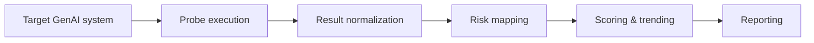

# AI Risk Inspector (Public Overview)

**AI Risk Inspector** is a proprietary GenAI risk-assessment platform that helps security teams evaluate LLM-based systems across **security, privacy, ethics, and compliance** risk domains, and turn the results into evidence that executives, auditors, and regulators can use.

This repository is a **public, non-code overview**: architecture, methodology, and sanitized examples. No proprietary source code is included.

  
  
  

---

## Why this exists

Most organizations adopt GenAI quickly but lack an operational risk model that security teams can run repeatedly and report on. Policies and principles documents do not tell a board how a system actually behaved under attack. AI Risk Inspector was built to bridge that gap: make GenAI risk **measurable, repeatable, and reportable**.

## What it does

- **Executes automated risk probes** against LLM-based applications, assistants, RAG systems, and agents
- **Maps findings to risk domains** (Security / Privacy / Ethics / Compliance) and to external frameworks (OWASP Top 10 for LLM Applications, NIST AI RMF)
- **Scores and trends** results over time so teams can show improvement, regression, and residual risk
- **Generates reports** for two audiences: an executive summary for leadership and governance committees, and detailed technical findings with reproduction context for engineering

## Architecture (high level)

| Layer | Responsibility |
|---|---|
| **Probe execution** | Orchestrates test runs against the target, captures full request/response traces |
| **Result normalization** | Converts heterogeneous outputs into a common finding schema |
| **Risk mapping** | Classifies each finding into a risk domain and framework control |
| **Scoring & trending** | Aggregates by domain and severity; tracks results across assessments |
| **Reporting** | Produces executive and technical outputs |

More detail: [docs/architecture](docs/architecture/README.md) · [docs/methodology](docs/methodology/README.md) · [docs/examples](docs/examples/README.md)

> Implementation details, probe content, and scoring weights are intentionally omitted.

## Demo

A walkthrough of an assessment run and the resulting report: **https://youtu.be/0Lm11OSdJnw**

## Related work

- [Break the Bot](https://breakbot.lufsec.com) — hands-on AI red-teaming workshop and CTF built on the same attack categories
- [LLM application security review checklist](https://github.com/lucianoferrari/security-playbooks-templates/blob/main/templates/llm-application-security-review-checklist.md) and [GenAI incident playbook](https://github.com/lucianoferrari/security-playbooks-templates/blob/main/playbooks/genai-security-incident-playbook.md) — the governance side of the same problem
- [Prompt Injection Is a Business Risk, Not a Bug](https://github.com/lucianoferrari/security-writing/blob/main/essays/prompt-injection-is-a-business-risk.md) — why testing and evidence matter more than filters

## Status

Private, production-grade tool used in real assessments. This repository exists for employer, client, and community context. For a demo or a conversation about using it, reach out on LinkedIn.

## Author

**Luciano Ferrari** — Cybersecurity executive · C|RAGE, CISSP, CISM, CRISC, C|CISO
[LinkedIn](https://www.linkedin.com/in/lucianoferrari) · [LufSec](https://lufsec.com) · [GitHub](https://github.com/lucianoferrari)
